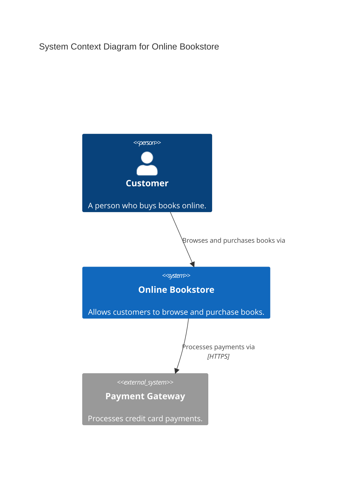
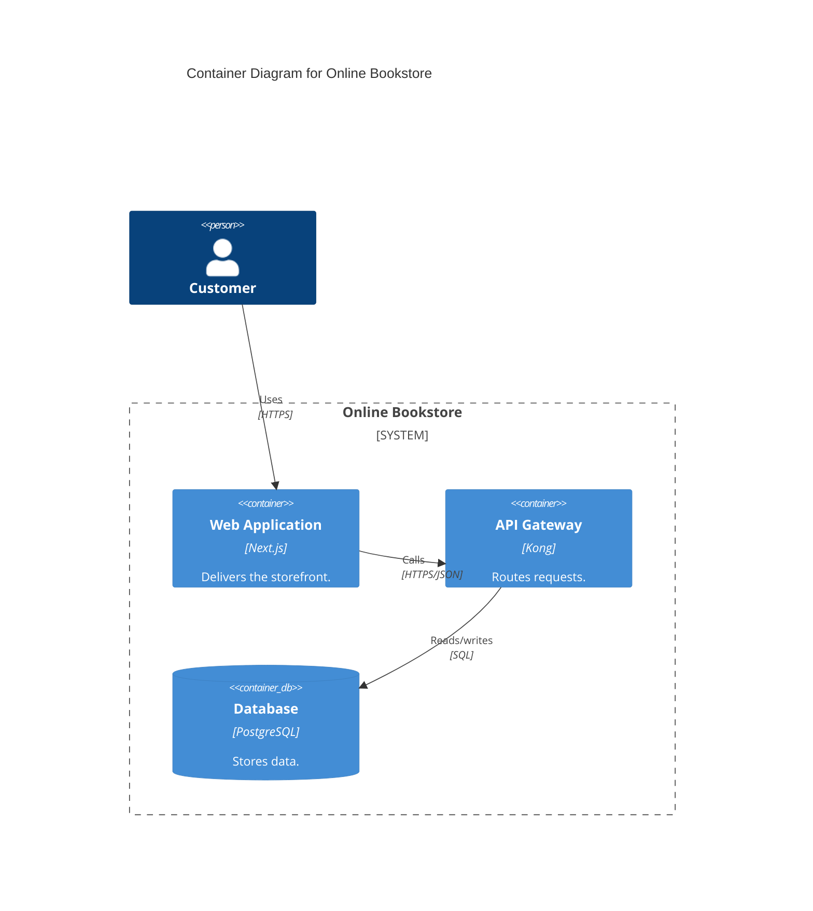

<!-- Part of the specs-diagramming-c4-diagrams skill. Loaded on demand from SKILL.md. -->

# C4 Model Diagrams — details

## Mermaid C4 Support

Mermaid supports C4 diagrams natively, making it possible to embed C4 models directly in Markdown rendered by GitHub, GitLab, and other platforms.

