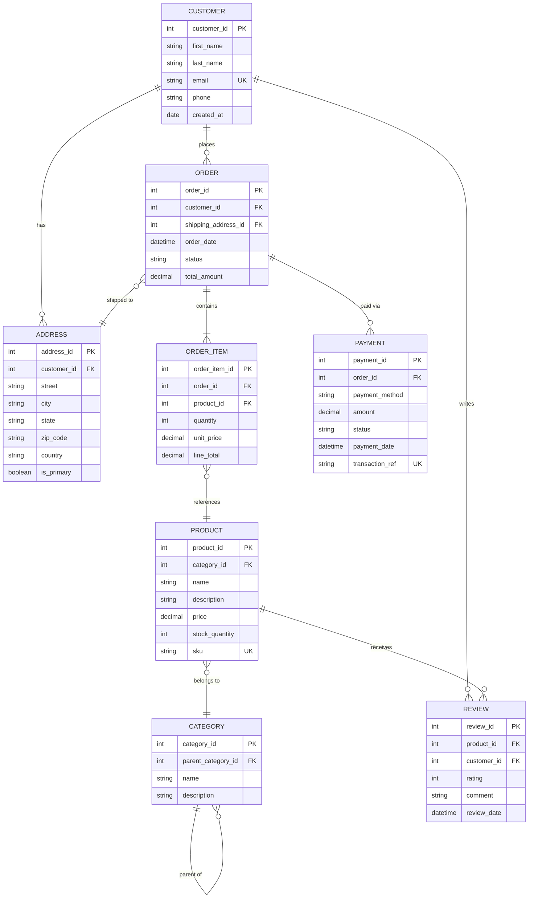

<!-- Part of the specs-diagramming-erd skill. Loaded on demand from SKILL.md. -->

# Mermaid ERD Syntax

Mermaid provides native support for ER diagrams using Crow's Foot-style notation.

## Relationship Symbols

| Symbol | Meaning |
|--------|---------|
| `\|\|` | Exactly one |
| `o\|` | Zero or one |
| `\|{` | One or many |
| `o{` | Zero or many |

Relationships are written as: `EntityA <relationship> EntityB : "label"`

## Attribute Types

Mermaid ERD attributes support type, name, and constraint markers:

```
erDiagram
    ENTITY {
        type attribute_name PK "comment"
        type attribute_name FK
        type attribute_name UK "unique key"
    }
```

## Complete Mermaid ERD Example: E-Commerce Database



## Mermaid ERD Relationship Syntax Reference

```
erDiagram
    %% One-to-one (both mandatory)
    PERSON ||--|| PASSPORT : "holds"

    %% One-to-many (mandatory on both sides)
    DEPARTMENT ||--|{ EMPLOYEE : "employs"

    %% One-to-many (optional on many side)
    CUSTOMER ||--o{ ORDER : "places"

    %% Many-to-many (resolved via junction table)
    STUDENT }o--o{ COURSE : "enrolls in"

    %% One-to-zero-or-one
    EMPLOYEE ||--o| PARKING_SPOT : "assigned"
```
