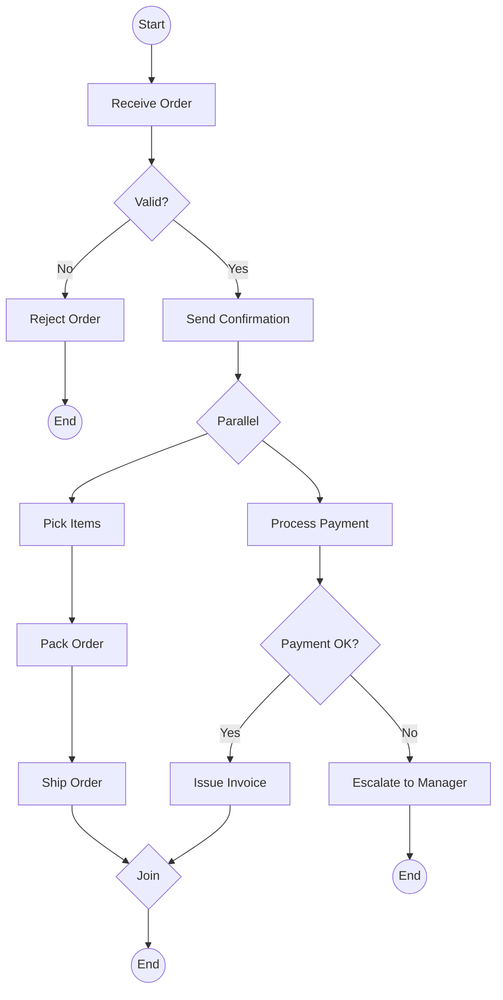

<!-- Part of the specs-diagramming-functional-diagrams skill. Loaded on demand from SKILL.md. -->

# BPMN (Business Process Model and Notation)

BPMN is an ISO standard (ISO/IEC 19510) for graphically representing business processes. It is the most widely used process modeling notation.

## Core BPMN Elements

### Flow Objects

| Element | Symbol | Description |
|---------|--------|-------------|
| **Task** | Rounded rectangle | An atomic activity within a process |
| **Sub-Process** | Rounded rectangle with + | A compound activity containing a nested process |
| **Event (Start)** | Thin circle | Indicates where a process begins |
| **Event (Intermediate)** | Double circle | Occurs between start and end |
| **Event (End)** | Thick circle | Indicates where a process ends |
| **Exclusive Gateway (XOR)** | Diamond with X | Decision point, only one path taken |
| **Parallel Gateway (AND)** | Diamond with + | All paths are taken simultaneously |
| **Inclusive Gateway (OR)** | Diamond with O | One or more paths taken |
| **Event-Based Gateway** | Diamond with pentagon | Path determined by event occurrence |

### Swimlane Elements

| Element | Description |
|---------|-------------|
| **Pool** | A container representing a participant (organization, system, role) |
| **Lane** | A sub-partition within a pool, typically representing a specific role or department |

### Connecting Objects

| Element | Description |
|---------|-------------|
| **Sequence Flow** | Solid arrow showing order of activities within a pool |
| **Message Flow** | Dashed arrow showing communication between pools |
| **Association** | Dotted line connecting data objects or annotations to flow objects |

### Data Elements

| Element | Description |
|---------|-------------|
| **Data Object** | Information required or produced by a task |
| **Data Store** | A persistent repository |

## BPMN Example: Order Fulfillment Process

```
┌──────────────────────────────────────────────────────────────────────┐
│ Pool: Order Fulfillment                                               │
│                                                                       │
│ ┌─────────────────────────────────────────────────────────────────┐  │
│ │ Lane: Sales                                                      │  │
│ │                                                                  │  │
│ │  (○)──►[Receive Order]──►<X>──►[Send Confirmation]──►           │  │
│ │  Start                   │                                       │  │
│ │                     invalid                                      │  │
│ │                          │                                       │  │
│ │                          ▼                                       │  │
│ │                   [Reject Order]──►(●)                           │  │
│ │                                   End                            │  │
│ └──────────────────────────────────┼──────────────────────────────┘  │
│                                     │ valid                          │
│ ┌──────────────────────────────────▼──────────────────────────────┐  │
│ │ Lane: Warehouse                                                  │  │
│ │                                                                  │  │
│ │  [Pick Items]──►[Pack Order]──►[Ship Order]──►(●)               │  │
│ │                                                End               │  │
│ └──────────────────────────────────────────────────────────────────┘  │
│                                                                       │
│ ┌──────────────────────────────────────────────────────────────────┐  │
│ │ Lane: Finance                                                    │  │
│ │                                                                  │  │
│ │  [Process Payment]──►<X>──►[Issue Invoice]──►(●)                │  │
│ │                       │                      End                 │  │
│ │                  failed│                                          │  │
│ │                       ▼                                          │  │
│ │                [Escalate to Manager]──►(●)                       │  │
│ │                                       End                        │  │
│ └──────────────────────────────────────────────────────────────────┘  │
└──────────────────────────────────────────────────────────────────────┘

Legend: (○) = Start Event, (●) = End Event, <X> = Exclusive Gateway
        [Task] = Task/Activity
```

## BPMN in Mermaid

Mermaid does not have native BPMN support, but flowchart syntax can approximate BPMN processes:


