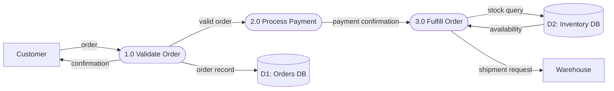

<!-- Part of the specs-diagramming-functional-diagrams skill. Loaded on demand from SKILL.md. -->

# Data Flow Diagrams (DFD)

DFDs show how data is processed by a system. They use four core element types and are organized into hierarchical levels.

## DFD Elements

| Element | Symbol | Description |
|---------|--------|-------------|
| **Process** | Circle or rounded rectangle | Transforms input data into output data |
| **Data Store** | Open-ended rectangle (parallel lines) | Repository where data is held for later use |
| **External Entity** | Rectangle (square) | Source or sink of data outside the system boundary |
| **Data Flow** | Arrow with label | Movement of data between elements |

## DFD Levels

DFDs are organized hierarchically, with each level providing more detail:

```
┌─────────────────────────────────────────────────────────┐
│ Context Diagram (Level -1)                               │
│                                                          │
│  ┌──────────┐    order     ┌──────────┐   receipt       │
│  │ Customer  │────────────►│  Order    │──────────►      │
│  │ (External)│◄────────────│  System   │   ┌──────────┐ │
│  └──────────┘  confirmation│ (Process) │──►│ Warehouse│ │
│                             └──────────┘   │ (External)│ │
│                                            └──────────┘ │
│  Shows: entire system as ONE process                     │
└─────────────────────────────────────────────────────────┘

┌─────────────────────────────────────────────────────────┐
│ Level 0 Diagram                                          │
│                                                          │
│  ┌──────────┐  order   ┌─────────┐  valid   ┌────────┐ │
│  │ Customer  │────────►│ 1.0     │  order   │ 2.0    │ │
│  │           │         │ Validate │────────►│ Process │ │
│  └──────────┘         │ Order   │         │ Payment │ │
│                        └─────────┘         └───┬────┘ │
│                             │                   │      │
│                        error│              payment     │
│                             ▼              info │      │
│                        ┌─────────┐              ▼      │
│                        │ D1:     │         ┌────────┐ │
│                        │ Error   │         │ 3.0    │ │
│                        │ Log     │         │ Fulfill │ │
│                        └─────────┘         │ Order  │ │
│                                            └───┬────┘ │
│  Shows: major processes within the system       │      │
│                                           shipment    │
│                                            info │      │
│                                                 ▼      │
│                                           ┌──────────┐ │
│                                           │ Warehouse│ │
│                                           └──────────┘ │
└─────────────────────────────────────────────────────────┘

┌─────────────────────────────────────────────────────────┐
│ Level 1+ Diagrams                                        │
│                                                          │
│  Explodes a single Level 0 process into sub-processes.   │
│  E.g., "1.0 Validate Order" becomes:                     │
│                                                          │
│  ┌─────────┐ order  ┌─────────┐ checked  ┌─────────┐   │
│  │ 1.1     │───────►│ 1.2     │────────►│ 1.3     │   │
│  │ Check   │        │ Verify  │          │ Confirm │   │
│  │ Syntax  │        │ Stock   │          │ Price   │   │
│  └─────────┘        └────┬────┘          └─────────┘   │
│                          │                              │
│                     ┌────▼────┐                          │
│                     │ D2:     │                          │
│                     │ Inventory│                          │
│                     │ DB       │                          │
│                     └─────────┘                          │
└─────────────────────────────────────────────────────────┘
```

## DFD Rules
1. **All data flows must be labeled.** Unlabeled arrows are ambiguous.
2. **No data flow between two external entities.** The diagram models the system, not the outside world.
3. **No data flow between two data stores.** Data movement requires a process.
4. **Every process must have at least one input and one output.** A process with no inputs is a "miracle"; a process with no outputs is a "black hole."
5. **Data stores must connect to processes, not external entities.** External entities interact through processes.
6. **Level numbers must be consistent.** Sub-processes of Process 1.0 are 1.1, 1.2, 1.3, etc.

## DFD in Mermaid Syntax

Mermaid does not have native DFD support, but flowchart syntax can represent DFD concepts:


