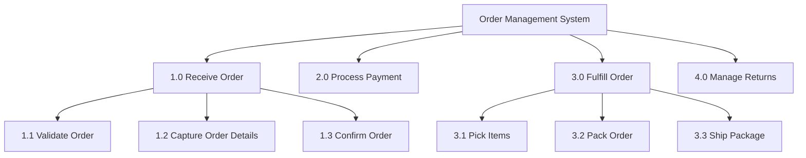

<!-- Part of the specs-diagramming-functional-diagrams skill. Loaded on demand from SKILL.md. -->

# Functional Decomposition

Functional decomposition breaks a system into hierarchical sub-functions. Each level reveals more detail about how a function is accomplished.

## Decomposition Tree Structure

```
┌──────────────────────────────────────────┐
│         Order Management System           │
│              (Level 0)                    │
└──────────────┬───────────────────────────┘
               │
    ┌──────────┼──────────────┬─────────────────┐
    │          │              │                  │
    ▼          ▼              ▼                  ▼
┌────────┐ ┌────────┐  ┌──────────┐      ┌──────────┐
│ Receive│ │ Process│  │ Fulfill  │      │ Manage   │
│ Order  │ │ Payment│  │ Order    │      │ Returns  │
│ (1.0)  │ │ (2.0)  │  │ (3.0)   │      │ (4.0)    │
└───┬────┘ └───┬────┘  └────┬─────┘      └────┬─────┘
    │          │             │                  │
  ┌─┼─┐     ┌─┼─┐       ┌──┼──┐           ┌──┼──┐
  ▼ ▼ ▼     ▼ ▼ ▼       ▼  ▼  ▼           ▼  ▼  ▼
1.1 1.2    2.1 2.2     3.1 3.2 3.3       4.1 4.2 4.3
Val Cap    Auth Rec    Pick Pack Ship    Auth Proc Ref
```

## Decomposition Guidelines
- **Stop decomposing** when a function is simple enough to be implemented as a single unit of work.
- **Each parent function** should decompose into 2-7 child functions. Too few suggests unnecessary hierarchy; too many suggests the parent is not well-defined.
- **Naming convention:** Use verb-noun pairs (e.g., "Validate Order", "Process Payment", "Ship Package").
- **Maintain consistency:** All children at the same level should be at the same granularity.

## Functional Decomposition in Mermaid


