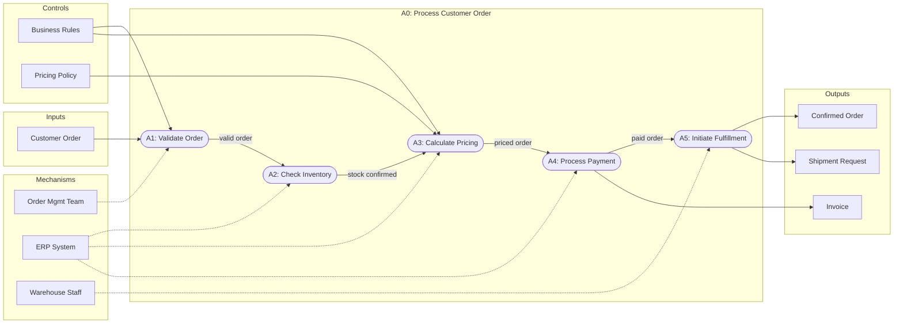

<!-- Part of the specs-diagramming-functional-diagrams skill. Loaded on demand from SKILL.md. -->

# IDEF0 (Integration Definition for Function Modeling)

IDEF0 models functions (activities, processes, operations) and the data/objects that inter-relate those functions. Each function is represented as a box with four types of arrows.

## ICOM Convention

```
        Controls (top)
            │
            ▼
    ┌───────────────┐
    │               │
Inputs ──►│   Function    │──► Outputs
(left)    │               │    (right)
    └───────┬───────┘
            │
            ▲
        Mechanisms (bottom)
```

| Arrow Position | Name | Description | Example |
|---------------|------|-------------|---------|
| **Left** (entering) | Inputs | Data or objects transformed by the function | Raw order data |
| **Top** (entering) | Controls | Conditions, rules, or constraints that govern the function | Business rules, regulations |
| **Right** (exiting) | Outputs | Data or objects produced by the function | Validated order |
| **Bottom** (entering) | Mechanisms | Resources that perform the function | Staff, software, equipment |

## IDEF0 Example: Process Customer Order

```
              Business Rules     Pricing Policy
                   │                  │
                   ▼                  ▼
              ┌──────────────────────────────┐
              │                              │
Customer  ──►│    Process Customer Order     │──► Confirmed Order
Order         │          (A0)                │──► Invoice
              │                              │──► Shipment Request
              └──────────────┬───────────────┘
                             │
                  ┌──────────┼──────────┐
                  ▲          ▲          ▲
              Order Mgmt   ERP       Warehouse
              Team        System     Staff
```

## IDEF0 Decomposition

Like DFDs, IDEF0 diagrams decompose hierarchically:
- **A-0:** Top-level context diagram (single box)
- **A0:** First decomposition (3-6 child functions)
- **A1, A2, ...:** Further decomposition of each function

```
A-0: Process Customer Order
 └── A0 Decomposition:
      ├── A1: Validate Order
      ├── A2: Check Inventory
      ├── A3: Calculate Pricing
      ├── A4: Process Payment
      └── A5: Initiate Fulfillment
```

## IDEF0 Rules
1. **Each function box must have at least one control and one output.** Inputs and mechanisms may be optional.
2. **3-6 functions per diagram.** Too few does not add value; too many becomes unreadable.
3. **Arrows between boxes model data/object flow.** An output of one function can become the input or control of another.
4. **Boundary arrows** connect to parent diagram arrows via ICOM codes.
5. **Node numbering:** A0 decomposes to A1-A6; A1 decomposes to A11-A16; etc.

## IDEF0 in Mermaid


