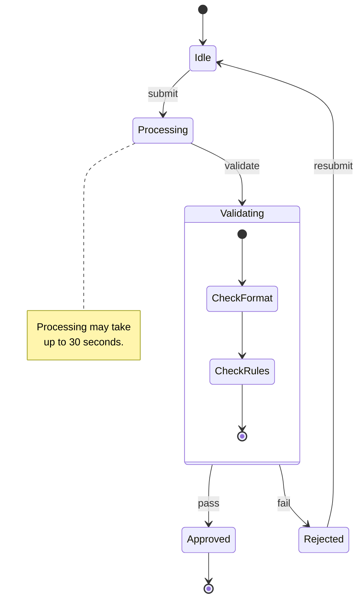
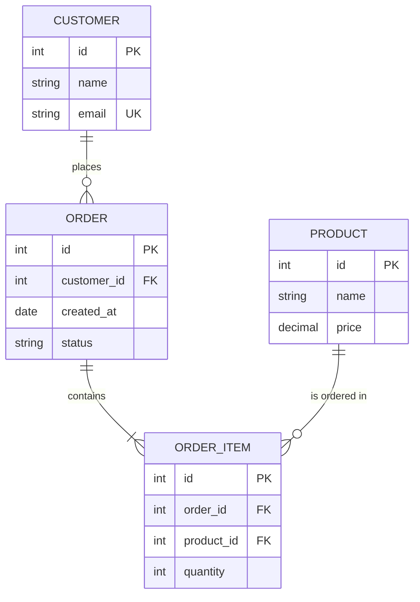
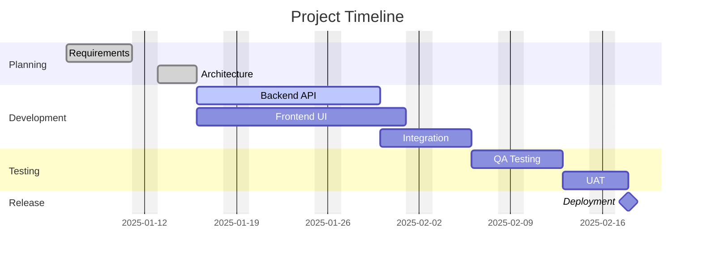
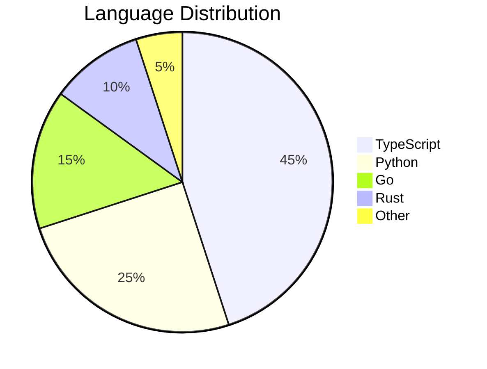
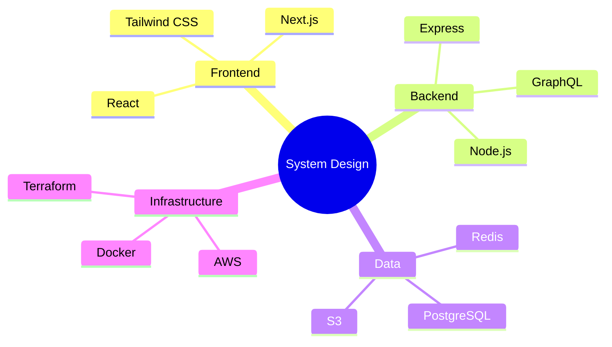
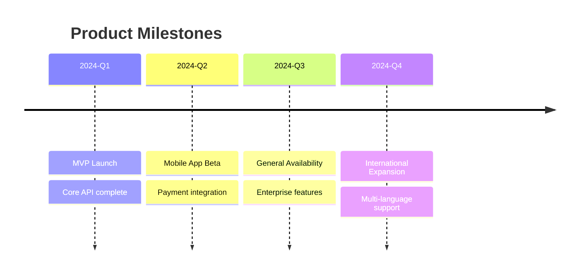
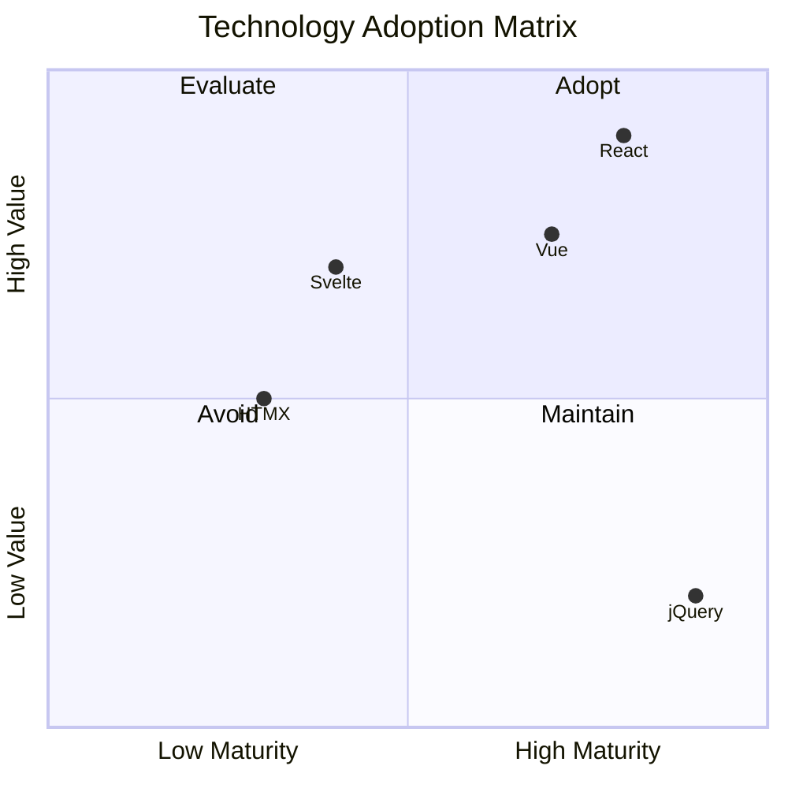
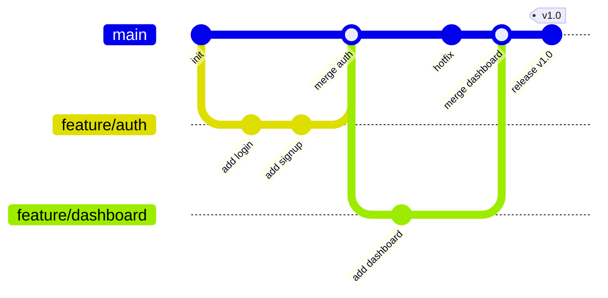
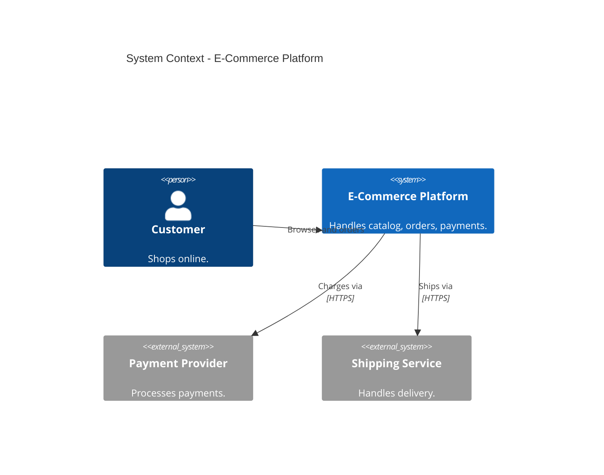
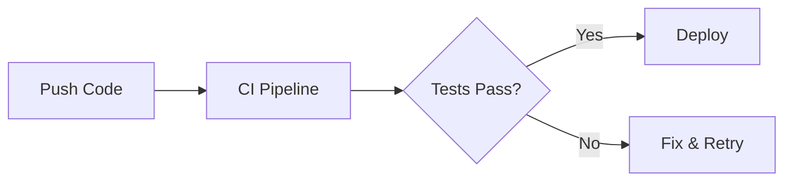

# Mermaid.js

## Overview

Mermaid.js is a JavaScript-based text-to-diagram tool that renders diagrams from Markdown-like syntax. It is the de facto standard for embedding diagrams in Markdown because GitHub, GitLab, Azure DevOps, Notion, Docusaurus, and many other platforms render Mermaid code blocks natively. You write text; the platform renders a diagram.

## State Diagram

Models state machine transitions.

````markdown

````

## Entity Relationship Diagram

Models data relationships with cardinality.

````markdown

````

### Cardinality Notation

| Syntax | Meaning |
|--------|---------|
| `\|\|` | Exactly one |
| `o\|` | Zero or one |
| `}o` | Zero or many |
| `}\|` | One or many |

## Gantt Chart

````markdown

````

## Pie Chart

````markdown

````

## Mindmap

````markdown

````

## Timeline

````markdown

````

## Quadrant Chart

````markdown

````

## Git Graph

````markdown

````

## C4 Diagrams in Mermaid

````markdown

````

## GitHub / GitLab Rendering

Mermaid diagrams render natively in GitHub and GitLab Markdown. Simply use a fenced code block with the `mermaid` language identifier.

````markdown

````

This works in:
- README.md and any Markdown file in the repository
- Pull request descriptions and comments
- Issue descriptions and comments
- Wiki pages
- GitHub Discussions

## Configuration via Front Matter

For Markdown files, you can configure Mermaid using YAML front matter:

```yaml
---
config:
  theme: dark
  flowchart:
    curve: basis
---
```

## Best Practices

- **Use Mermaid for documentation-embedded diagrams.** Its native rendering on GitHub and GitLab makes it ideal for READMEs, PRs, ADRs, and wiki pages.
- **Keep diagrams small and focused.** If a diagram has more than 15-20 nodes, split it into multiple diagrams.
- **Choose the right diagram type.** Use flowcharts for processes, sequence diagrams for interactions, class diagrams for structure, ER diagrams for data models.
- **Use subgraphs in flowcharts** to visually group related nodes (e.g., "Frontend", "Backend", "Database Layer").
- **Add labels to all links.** Unlabeled arrows create ambiguity. Always describe what flows along a connection.
- **Use `LR` (left-to-right) for process flows** and `TD` (top-down) for hierarchies.
- **Use aliases for readability.** In sequence diagrams, `participant API as API Server` makes the diagram source easier to read while showing a clean label.
- **Leverage alt/loop/par blocks** in sequence diagrams to show conditional logic, loops, and parallel processing.
- **Test locally before committing.** Use the Mermaid Live Editor (https://mermaid.live) to preview and debug diagrams.
- **Pin the Mermaid version** in documentation sites (Docusaurus, MkDocs) to avoid rendering changes from upstream updates.
- **Use themes consistently** across a project. Set a theme directive at the top of each diagram or configure it globally in your documentation framework.
- **Escape special characters.** Mermaid uses characters like `{}`, `()`, `[]`, `<>` for syntax. Wrap labels containing these in quotes.

## Detailed reference

Load only the file that matches the task — each is self-contained.

| File | Contents |
|---|---|
| [references/details.md](references/details.md) | Supported Diagram Types; Flowchart; Sequence Diagram; Class Diagram; Directives and Themes |

## References

- [Mermaid.js Official Documentation](https://mermaid.js.org/)
- [Mermaid.js — GitHub Repository](https://github.com/mermaid-js/mermaid)

See references/rules.md for the full rule catalog.
