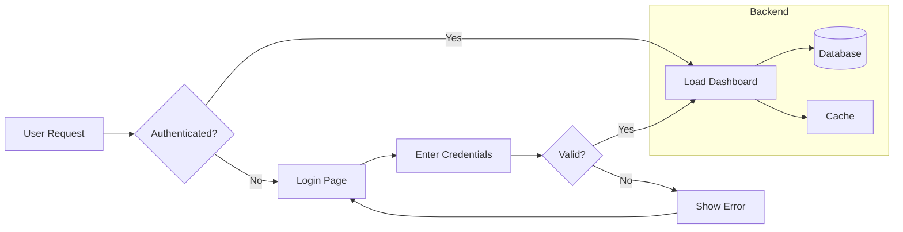
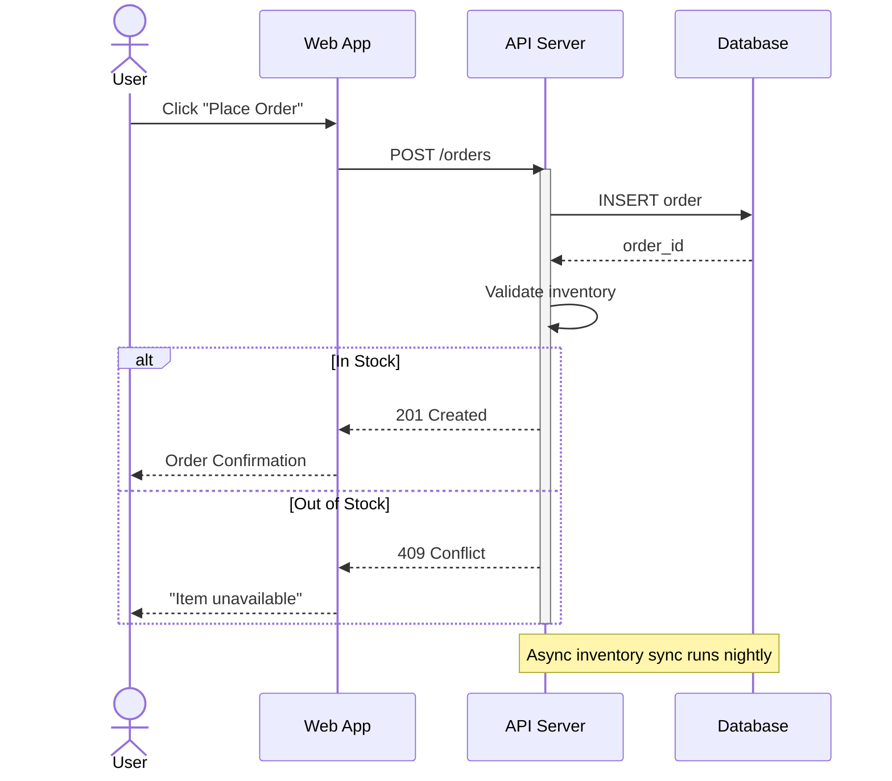
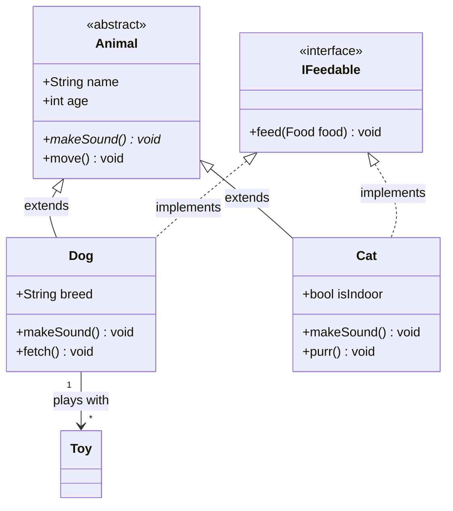
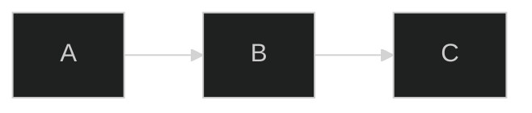

<!-- Part of the specs-diagramming-mermaidjs skill. Loaded on demand from SKILL.md. -->

# Mermaid.js — details

## Supported Diagram Types

| Diagram | Keyword | Purpose |
|---------|---------|---------|
| Flowchart | `flowchart` or `graph` | Process flows, decision trees, workflows |
| Sequence | `sequenceDiagram` | Interaction order between participants |
| Class | `classDiagram` | Object-oriented structure and relationships |
| State | `stateDiagram-v2` | State machine transitions |
| Entity Relationship | `erDiagram` | Data model relationships |
| Gantt | `gantt` | Project scheduling and timelines |
| Pie | `pie` | Proportional data |
| Mindmap | `mindmap` | Hierarchical idea mapping |
| Timeline | `timeline` | Chronological events |
| Quadrant | `quadrantChart` | 2x2 categorization matrix |
| C4 Context | `C4Context` | C4 Level 1 diagrams |
| C4 Container | `C4Container` | C4 Level 2 diagrams |
| Git Graph | `gitGraph` | Branch and commit visualization |

## Flowchart

The most commonly used diagram type. Supports directional layouts, shape types, subgraphs, and link styles.

### Directions

| Direction | Meaning |
|-----------|---------|
| `TB` or `TD` | Top to Bottom |
| `BT` | Bottom to Top |
| `LR` | Left to Right |
| `RL` | Right to Left |

### Node Shapes

| Syntax | Shape |
|--------|-------|
| `A[Text]` | Rectangle |
| `A(Text)` | Rounded rectangle |
| `A([Text])` | Stadium / pill |
| `A{Text}` | Diamond (decision) |
| `A{{Text}}` | Hexagon |
| `A[[Text]]` | Subroutine |
| `A[(Text)]` | Cylinder (database) |
| `A((Text))` | Circle |
| `A>Text]` | Asymmetric / flag |

### Full Example

````markdown

````

### Link Types

| Syntax | Type |
|--------|------|
| `-->` | Arrow |
| `---` | Line (no arrow) |
| `-.->` | Dotted arrow |
| `==>` | Thick arrow |
| `--text-->` | Arrow with label |
| `-.text.->` | Dotted arrow with label |

## Sequence Diagram

Shows the order of interactions between participants over time.

````markdown

````

### Arrow Types

| Syntax | Meaning |
|--------|---------|
| `->>` | Solid arrow (synchronous) |
| `-->>` | Dashed arrow (response / async) |
| `-x` | Solid with cross (lost message) |
| `--x` | Dashed with cross |
| `-)` | Solid open arrow (async fire-and-forget) |
| `--)` | Dashed open arrow |

### Features

- `activate` / `deactivate` for activation bars
- `alt` / `else` / `end` for conditional logic
- `loop` / `end` for repetition
- `par` / `and` / `end` for parallel processing
- `critical` / `option` / `end` for critical regions
- `Note over A,B: text` for annotations
- `rect rgb(...)` for background highlighting

## Class Diagram

Models object-oriented structure with classes, interfaces, relationships, and visibility.

````markdown

````

### Visibility Modifiers

| Symbol | Meaning |
|--------|---------|
| `+` | Public |
| `-` | Private |
| `#` | Protected |
| `~` | Package/Internal |

### Relationship Types

| Syntax | Meaning |
|--------|---------|
| `<\|--` | Inheritance |
| `<\|..` | Implementation (interface) |
| `*--` | Composition |
| `o--` | Aggregation |
| `-->` | Association |
| `..>` | Dependency |
| `--` | Link (solid) |
| `..` | Link (dashed) |

## Directives and Themes

### Directives

Directives configure diagram behavior inline. Place them at the top of the diagram block.

````markdown

````

### Built-in Themes

| Theme | Description |
|-------|-------------|
| `default` | Standard light theme |
| `dark` | Dark background |
| `forest` | Green-toned |
| `neutral` | Grayscale |
| `base` | Minimal starting point for customization |

### Custom Theme Variables

```
%%{init: {'theme': 'base', 'themeVariables': {
    'primaryColor': '#4C566A',
    'primaryTextColor': '#ECEFF4',
    'primaryBorderColor': '#D8DEE9',
    'lineColor': '#88C0D0',
    'secondaryColor': '#5E81AC',
    'tertiaryColor': '#2E3440'
}}}%%
```
