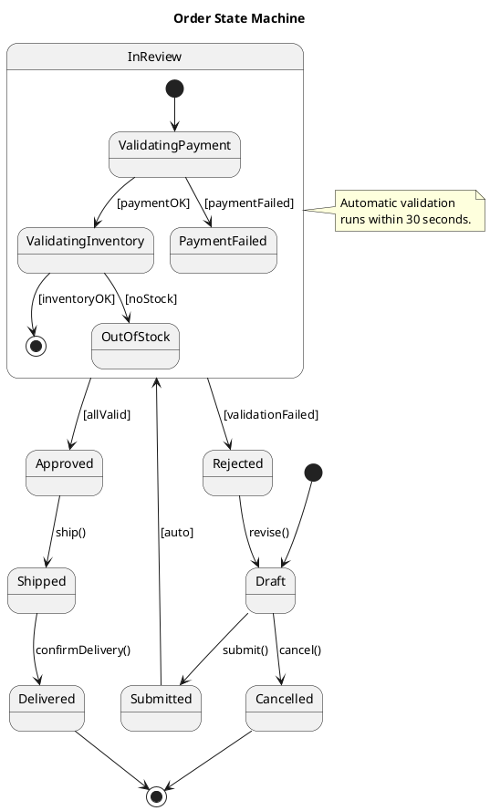

# PlantUML

## Overview

PlantUML is an open-source tool that renders UML diagrams from a plain text description language. Diagrams are defined between `@startuml` and `@enduml` tags. PlantUML supports all major UML diagram types plus additional diagrams like network diagrams, Gantt charts, and mind maps. It integrates with IDEs, CI pipelines, and documentation tools, and can generate PNG, SVG, EPS, and ASCII art output.

## State Diagram



## Includes and File Organization

### !include Directive

```plantuml
@startuml
' Include from a local file
!include common-styles.puml
!include domain/user.puml
!include domain/order.puml

' Include from a URL
!include https://raw.githubusercontent.com/plantuml-stdlib/C4-PlantUML/master/C4_Container.puml

User --> Order

@enduml
```

### Defining Reusable Fragments

**common-styles.puml:**
```plantuml
skinparam class {
    BackgroundColor #4C566A
    BorderColor #D8DEE9
    FontColor #ECEFF4
}

skinparam defaultFontName "Segoe UI"
```

**domain/user.puml:**
```plantuml
class User {
    - id: Long
    - email: String
    - name: String
    + getEmail(): String
}
```

## Best Practices

- **Use `@startuml` / `@enduml` blocks.** Every PlantUML diagram must be wrapped in these tags. The optional name after `@startuml` becomes the output filename.
- **Organize with `!include`.** Split large models into separate `.puml` files per domain concept and compose them with includes.
- **Use skinparam for consistent styling.** Define a shared style file and `!include` it in every diagram for visual consistency.
- **Use built-in themes** for quick, professional styling. `!theme cerulean` or `!theme blueprint` are good defaults.
- **Leverage the preprocessor.** Use variables for colors, procedures for reusable shapes, and conditionals for environment-specific rendering.
- **Use C4-PlantUML for architecture diagrams.** The C4-PlantUML library provides well-designed macros that produce clean, standardized C4 diagrams.
- **Use aliases for readability.** `participant "API Server" as API` makes source readable while producing clean output.
- **Keep sequence diagrams focused.** If a sequence diagram has more than 7-8 participants or 20+ messages, split it into multiple diagrams with `ref` fragments.
- **Use `left to right direction`** in use case and component diagrams to improve readability for systems with many elements.
- **Generate SVG for documentation.** SVG scales better than PNG and is searchable. Use `-tsvg` in CI pipelines.
- **Integrate with CI.** Add PlantUML rendering to your CI pipeline so diagrams are always up-to-date. Docker-based rendering avoids Java dependency issues.
- **Use the PlantUML server** for team environments. A shared server provides consistent rendering and can be used as a rendering service for documentation platforms.

## Detailed reference

Load only the file that matches the task — each is self-contained.

| File | Contents |
|---|---|
| [references/sequence-diagram.md](references/sequence-diagram.md) | Sequence Diagram — Participant Types, Arrow Types, Grouping and Fragments |
| [references/class-diagram.md](references/class-diagram.md) | Class Diagram — Relationship Syntax, Visibility Modifiers |
| [references/c4-plantuml-library.md](references/c4-plantuml-library.md) | C4-PlantUML Library — Installation, C4 Context Diagram, C4 Container Diagram, C4-PlantUML Macros |
| [references/details.md](references/details.md) | Activity Diagram; Component Diagram; Use Case Diagram; Object Diagram; Deployment Diagram; Skinparam and Theming; Preprocessing Directives; Running PlantUML |

## References

- [PlantUML Official Documentation](https://plantuml.com/)
- [PlantUML — GitHub Repository](https://github.com/plantuml/plantuml)

See references/rules.md for the full rule catalog.
