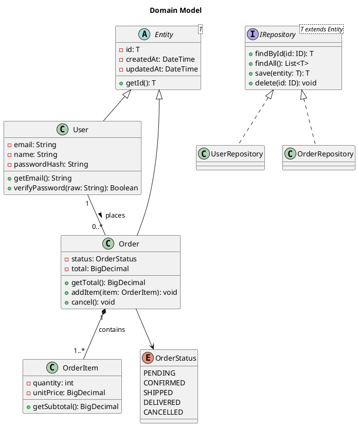

<!-- Part of the specs-diagramming-plantuml skill. Loaded on demand from SKILL.md. -->

# Class Diagram

## Relationship Syntax

| Syntax | Meaning |
|--------|---------|
| `A <\|-- B` | B extends A (inheritance) |
| `A <\|.. B` | B implements A (realization) |
| `A *-- B` | A is composed of B (composition) |
| `A o-- B` | A aggregates B (aggregation) |
| `A --> B` | A depends on / uses B (directed association) |
| `A -- B` | Association |
| `A ..> B` | Dependency |
| `A -- "label" B` | Association with label |
| `A "1" -- "0..*" B` | Association with multiplicity |

## Visibility Modifiers

| Symbol | Visibility |
|--------|-----------|
| `+` | Public |
| `-` | Private |
| `#` | Protected |
| `~` | Package |
| `{abstract}` | Abstract method |
| `{static}` | Static member |
