<!-- Part of the specs-diagramming-plantuml skill. Loaded on demand from SKILL.md. -->

# PlantUML — details

## Activity Diagram

PlantUML supports both legacy and modern (beta) activity diagram syntax. The modern syntax is recommended.

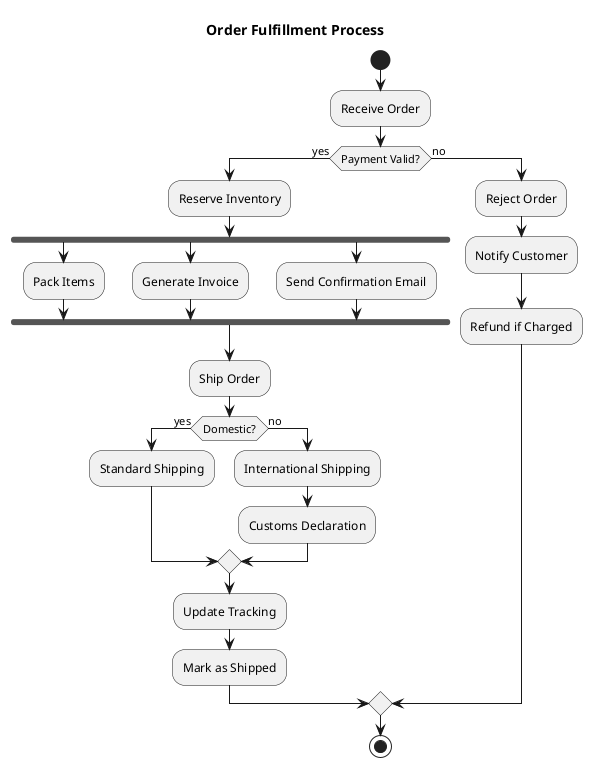

### Activity Diagram Elements

| Syntax | Meaning |
|--------|---------|
| `start` | Start node |
| `stop` | Stop node (success) |
| `end` | End node (termination) |
| `:Action;` | Action / activity step |
| `if (cond) then (yes) ... else (no) ... endif` | Decision |
| `fork ... fork again ... end fork` | Parallel execution |
| `while (cond?) is (yes) ... endwhile (no)` | Loop |
| `repeat ... repeat while (cond?)` | Do-while loop |
| `\|swimlane\|` | Swimlane / partition |
| `#color:Action;` | Colored action |

### Swimlanes

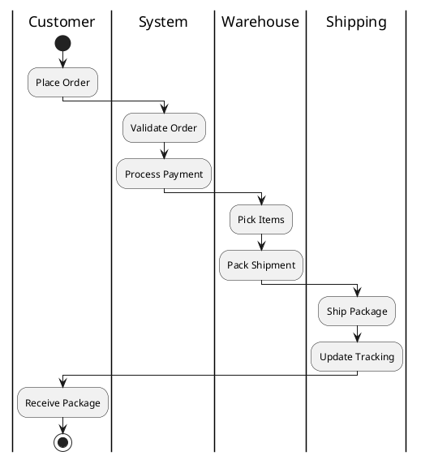

## Component Diagram

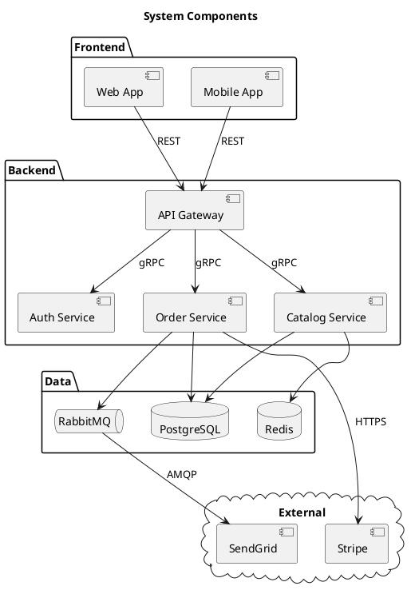

## Use Case Diagram

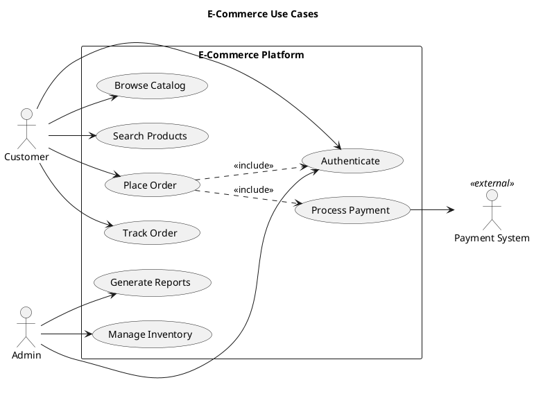

## Object Diagram

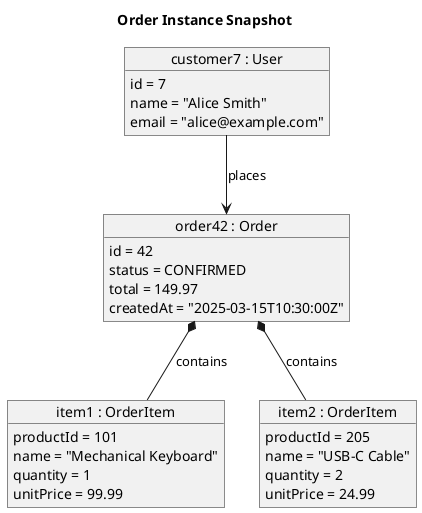

## Deployment Diagram

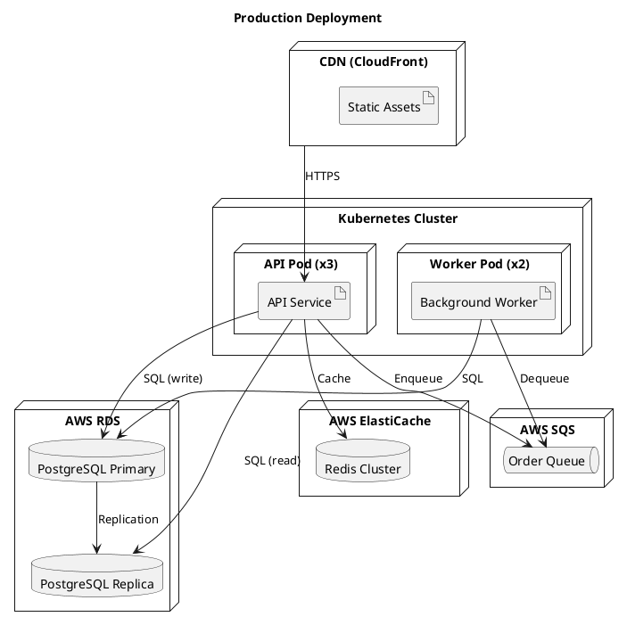

## Skinparam and Theming

### Skinparam

`skinparam` controls the visual appearance of all diagram elements.

```plantuml
@startuml

skinparam backgroundColor #2E3440
skinparam defaultFontColor #ECEFF4
skinparam defaultFontName "Segoe UI"
skinparam defaultFontSize 12

skinparam class {
    BackgroundColor #4C566A
    BorderColor #D8DEE9
    FontColor #ECEFF4
    ArrowColor #88C0D0
    StereotypeFontColor #81A1C1
}

skinparam note {
    BackgroundColor #3B4252
    BorderColor #4C566A
    FontColor #ECEFF4
}

skinparam package {
    BackgroundColor #3B4252
    BorderColor #4C566A
    FontColor #D8DEE9
}

class User {
    + name: String
    + email: String
}

class Order {
    + total: Decimal
    + status: Status
}

User --> Order

@enduml
```

### Common Skinparam Properties

| Property | Description |
|----------|-------------|
| `BackgroundColor` | Shape fill color |
| `BorderColor` | Shape border color |
| `FontColor` | Text color |
| `FontSize` | Text size |
| `FontName` | Font family |
| `ArrowColor` | Connection line color |
| `ArrowThickness` | Connection line width |
| `Shadowing` | true/false for drop shadows |
| `RoundCorner` | Border radius in pixels |
| `Padding` | Internal padding |
| `Margin` | External margin |

### Built-in Themes

PlantUML includes built-in themes that can be applied with a single directive.

```plantuml
@startuml
!theme cerulean
' Other themes: amiga, blueprint, cerulean, crt-amber, crt-green,
' cyborg, hacker, lightgray, mars, materia, metal, minty, plain,
' reddress, sandstone, silver, sketchy-outline, spacelab, superhero,
' toy, united, vibrant

class Example {
    + field: Type
}

@enduml
```

## Preprocessing Directives

PlantUML includes a preprocessor with variables, conditionals, loops, and functions.

### Variables

```plantuml
@startuml
!$primary_color = "#5E81AC"
!$font_color = "#ECEFF4"
!$bg_color = "#2E3440"

skinparam backgroundColor $bg_color
skinparam class {
    BackgroundColor $primary_color
    FontColor $font_color
}

class Example {
    + field: Type
}

@enduml
```

### Conditionals

```plantuml
@startuml
!$env = "production"

!if ($env == "production")
    skinparam backgroundColor #2E3440
    skinparam defaultFontColor #ECEFF4
!else
    skinparam backgroundColor White
    skinparam defaultFontColor Black
!endif

class Config {
    + env: String
}

@enduml
```

### Procedures (Macros)

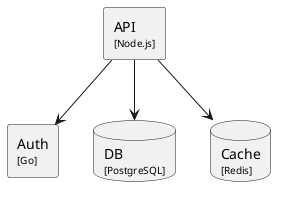

### Loops

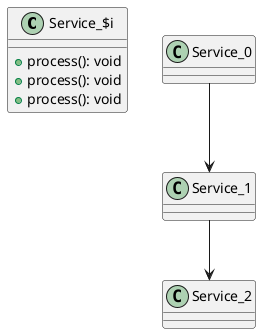

## Running PlantUML

### Command Line

```bash
# Generate PNG from a .puml file
java -jar plantuml.jar diagram.puml

# Generate SVG
java -jar plantuml.jar -tsvg diagram.puml

# Generate all diagrams in a directory
java -jar plantuml.jar -tsvg -o output/ src/diagrams/

# Generate from stdin
echo "@startuml\nA -> B\n@enduml" | java -jar plantuml.jar -pipe > diagram.png

# Use a config file for shared skinparam settings
java -jar plantuml.jar -config style.puml diagram.puml
```

### Docker

```bash
# Run PlantUML server
docker run -d -p 8080:8080 plantuml/plantuml-server:tomcat

# Generate via Docker (no local Java needed)
docker run --rm -v $(pwd):/data plantuml/plantuml -tsvg /data/diagram.puml
```

### IDE Integration

- **VS Code:** "PlantUML" extension by jebbs — provides syntax highlighting, live preview, and export.
- **IntelliJ IDEA:** Built-in PlantUML support via the PlantUML Integration plugin.
- **Confluence:** PlantUML plugin renders diagrams inline.
