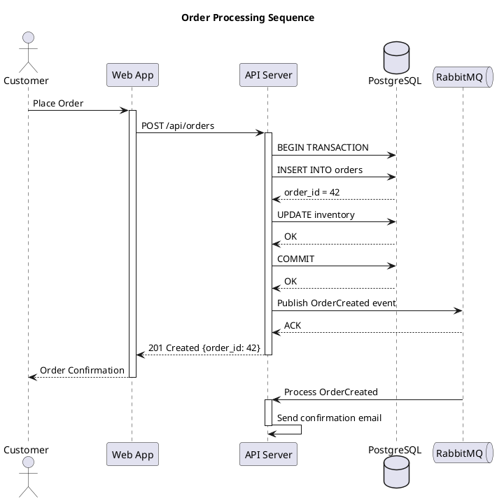
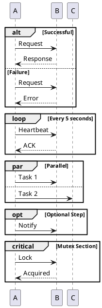

<!-- Part of the specs-diagramming-plantuml skill. Loaded on demand from SKILL.md. -->

# Sequence Diagram

The most commonly used PlantUML diagram type. Models the time-ordered exchange of messages between participants.

## Participant Types

| Keyword | Shape |
|---------|-------|
| `participant` | Rectangle (default) |
| `actor` | Stick figure |
| `boundary` | Boundary symbol |
| `control` | Control symbol |
| `entity` | Entity symbol |
| `database` | Cylinder |
| `collections` | Stacked rectangles |
| `queue` | Queue symbol |

## Arrow Types

| Syntax | Description |
|--------|-------------|
| `->` | Solid line, solid arrowhead |
| `-->` | Dashed line, solid arrowhead |
| `->>` | Solid line, thin arrowhead |
| `-->>` | Dashed line, thin arrowhead |
| `-\` | Solid line, upper half arrowhead |
| `-/` | Solid line, lower half arrowhead |
| `->x` | Solid line with lost message |
| `-[#red]>` | Colored arrow |

## Grouping and Fragments

